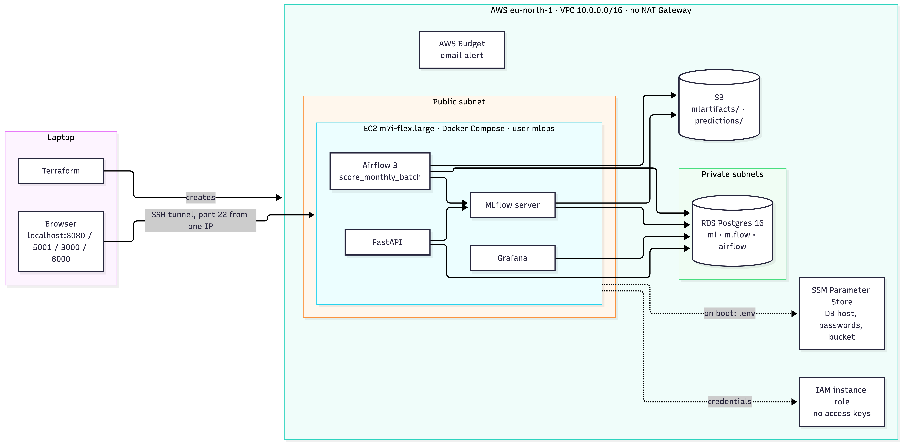
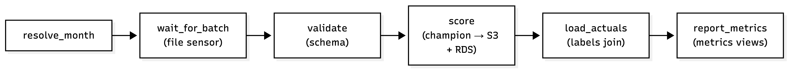

# Late delivery MLOps

Predicts whether an Olist order will arrive late, and runs that model the way a small production service would: monthly batch scoring in Airflow, an online API in FastAPI, MLflow as the model registry and Grafana for monitoring. It all runs on AWS and is built with Terraform.

I built this to practise the part of ML that notebooks skip: what happens after training, when new data comes in every month, labels show up late, and sooner or later something breaks.

Data: [Brazilian E-Commerce Public Dataset by Olist](https://www.kaggle.com/datasets/olistbr/brazilian-ecommerce).

## Model

- scikit-learn pipeline: schema check → seller late-rate encoding → features → one-hot → LightGBM.
- Time split: train 2017-01..11, validation 2017-12..2018-01, test 2018-02..03. The months 2018-04..08 are replayed as monthly batches; each month's labels arrive one month later.
- Threshold 0.405, chosen on validation by business cost.
- On the batch months the first champion (v1) gets recall 0.52–0.83 and precision 0.03–0.11. Only about 6% of orders are late and the threshold favours recall, so low precision is expected.

## Architecture



The EC2 machine keeps no state (data in RDS, artifacts in S3, secrets in SSM, code on GitHub), so it can be deleted and rebuilt without losing models or history.

### Monthly batch



Runs `@monthly` from 2018-04 to 2018-08 with catchup. Rerun any month with `-c '{"month": "2018-06"}'`. Tasks retry three times, except `validate`: a broken file won't fix itself on retry. The champion is loaded by version number, so promoting a new model mid-run doesn't swap the model under it.

### Monitoring

Dashboard and alerts are provisioned from `grafana/` and read from SQL views in `sql/views.sql`. Alerts fire when recall for the latest labelled month drops below 0.45, or when no batch has succeeded for 35 days.

## Failure exercises

I broke the system on purpose four times and wrote down the symptom, cause and fix for each: **[docs/failure_exercises.md](docs/failure_exercises.md)**

1. a bad model gets promoted, then rolled back;
2. a batch arrives with a renamed column;
3. the database goes down (the API returns 503, Airflow retries);
4. the EC2 instance is destroyed and rebuilt, with history intact.

## Repository

| Path | What |
|---|---|
| `train.py`, `config*.yaml` | Training; logs params, metrics and the model to MLflow and registers it |
| `src/registry.py` | `promote`, `challenger`, `rollback`, `show` for model aliases |
| `src/simulate.py` | Writes monthly batch and label files (`--rename` makes a broken batch) |
| `src/batch_scoring.py`, `dags/` | Batch steps and the Airflow DAG |
| `src/api.py` | FastAPI: `/predict`, `/health`, `/model-info` |
| `src/db.py`, `src/init_db.py`, `sql/` | Database layer, schema, views, setup |
| `grafana/` | Datasource, dashboard and alert rules as files |
| `docker-compose.yml`, `docker-compose.prod.yml` | Local stack; the prod file drops local Postgres for RDS |
| `terraform/` | VPC, security groups, EC2 + startup script, RDS, S3, IAM, SSM, budget |
| `docs/failure_exercises.md` | Four failure exercises: symptom, cause, fix |

## Run locally

Needs Docker and Python 3.12.

```bash
python -m venv .venv && .venv/bin/pip install -r requirements.txt
docker compose up -d --build     # postgres, mlflow :5001, airflow :8080, api :8000, grafana :3000
.venv/bin/python -m pytest -q
```

First model and batch:

```bash
.venv/bin/python train.py
.venv/bin/python -m src.registry promote 1
.venv/bin/python -m src.simulate next    # next month's batch + labels that are due
docker compose restart api               # the API loads the champion at startup
```

Then unpause `score_monthly_batch` in Airflow (http://localhost:8080). Grafana: http://localhost:3000, `admin` / `admin`.

```bash
curl localhost:8000/model-info
curl -X POST localhost:8000/predict -H 'Content-Type: application/json' -d '{
  "order_id": "o1", "order_purchase_timestamp": "2018-05-10T12:00:00",
  "total_price": 100, "total_freight": 15, "n_items": 1, "n_sellers": 1, "promised_days": 20,
  "customer_state": "SP", "seller_state": "RJ", "seller_id": "s1"}'
```

## Deploy to AWS

You need Terraform, the AWS CLI configured with an IAM user (not root), an SSH key (`ssh-keygen -t ed25519`), and the code pushed to `main` on GitHub, since the machine clones it.

```bash
cd terraform
cp terraform.tfvars.example terraform.tfvars   # your IP (/32), budget email; Free plan: instance_type = "m7i-flex.large"
terraform init && terraform apply              # ~10 min, mostly RDS
```

On boot the machine installs Docker, clones the repo, builds `.env` from SSM, creates the databases on RDS and starts Compose. Give it 5–15 minutes.

```bash
terraform output tunnel                               # run in its own terminal, keep it open
ssh ubuntu@<ip> 'sudo journalctl -u app -f'           # first boot progress
ssh mlops@<ip> 'cd /opt/app && docker compose ps'     # all healthy = ready
terraform output -raw grafana_password_command | sh   # Grafana password
```

First time only (empty registry, no batches):

```bash
# laptop, tunnel open
export MLFLOW_TRACKING_URI=http://127.0.0.1:5001
.venv/bin/python train.py && .venv/bin/python -m src.registry promote 1

# EC2
cd /opt/app
docker compose exec airflow bash -c "cd /opt/project && /opt/ml-venv/bin/python -m src.simulate next"
docker compose restart api
docker compose exec airflow airflow dags unpause score_monthly_batch
```

Rebuild only the machine (RDS, S3 and SSM stay; the champion loads from MLflow without retraining; new IP, so get the tunnel command again):

```bash
terraform apply -replace=aws_instance.app
```

Stop to save money (start RDS first, then EC2; a stopped RDS starts by itself after 7 days):

```bash
aws ec2 stop-instances  --region eu-north-1 --instance-ids $(terraform output -raw instance_id)
aws rds stop-db-instance --region eu-north-1 --db-instance-identifier late-delivery-db
```

Destroy everything, including RDS (no final snapshot) and the S3 bucket. Without the `force_destroy_bucket` flag, `destroy` stops at the bucket and the history survives:

```bash
terraform apply -var force_destroy_bucket=true
terraform destroy
```

## Cost

eu-north-1, on-demand, November 2026:

| Resource | Per month |
|---|---|
| EC2 m7i-flex.large (2 vCPU, 8 GB) | $74.3 |
| RDS db.t4g.micro, Single-AZ | $11.7 |
| Public IPv4 | $3.7 |
| EBS gp3 30 GB + RDS storage 20 GB | ~$5 |
| **Running 24/7** | **~$95** |
| Stopped | ~$5 |


## Things that bit me during deployment

- The AWS account only allows `eu-north-1` (an organization policy denies other regions).
- MLflow hung on model downloads. It was signing S3 URLs for the global endpoint, which answers 307 for buckets outside us-east-1. Fixed with `MLFLOW_S3_ENDPOINT_URL=https://s3.<region>.amazonaws.com`.
- Containers only get the instance role credentials with IMDSv2 hop limit 2.
- RDS for Postgres 15+ requires SSL (`DB_SSLMODE=require`).
- The RDS password has no special characters because it goes into connection URLs.
- If SSH stops working, your IP probably changed: update `allowed_ssh_cidr` and `terraform apply`.